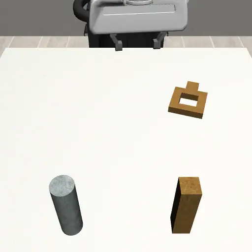
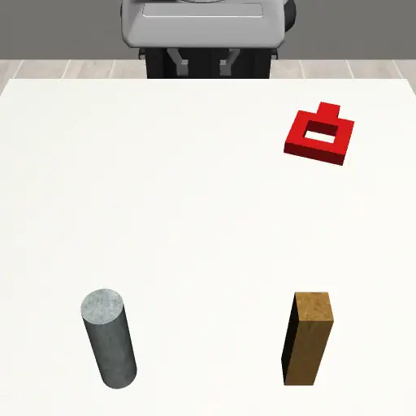
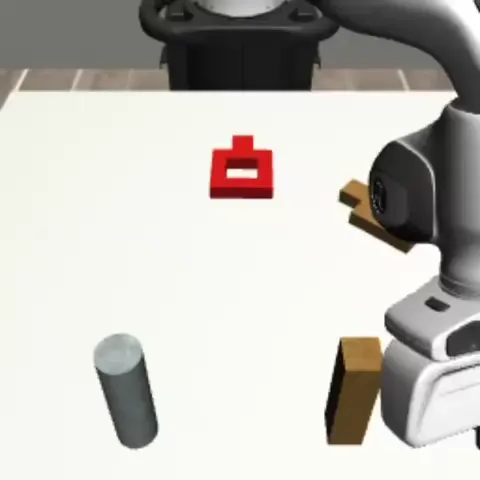
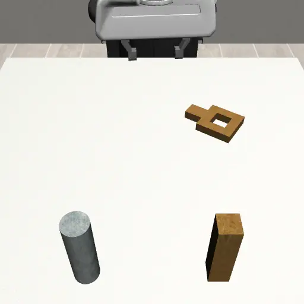
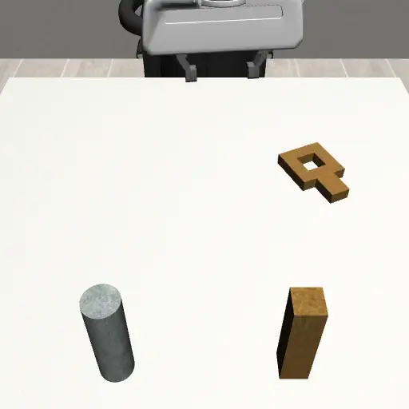
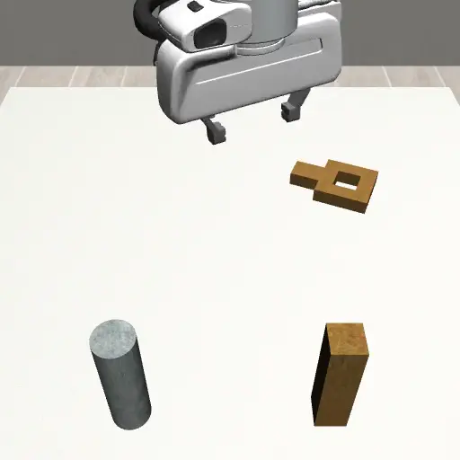

# 2026 Simulation-Based Machine Learning in Robotics: Evaluate DynaGuide Steering on a Nut Assembly Task Improving a Pre-Trained Diffusion Policy

In this project we implemented the complete training pipeline to use DynaGuide to fine tune a Diffusion policy solving the SquareNutAssembly task from mimicgen. The performance of DynaGuide is evaluated using several different experiments and later compared to DSRL for reference.

- The dataset is created using mimicgen
- The diffusion policy is trained using Robomimic
- DynaGuide is then applied using the original DynaGuide repo, but being adapted to fit the NutAssemblySquare task

As all three stages of the pipeline rely on robosuite in one kind or another to run rollouts / simulations. They all go hand in hand and provide an end-to-end pipeline from dataset generation over policy training to performance evaluation.

For newcomers to robosuite and the respecitive other libraries please note that robosuite is mostly a CLI simulator. Only when specified the rollouts will be rendered for you to view them. This can happen either live or as a .mp4 video to view afterwards.

Due to this circumstance robosuite and co. might seem unintuitive at first. Just note, that there is basically a script for everything you want to do. So don't worry and follow the descriptions closely.


### The Project is divided into several phases:

1. Create a suitable dataset: See [Dataset Preparation](Dataset_Preparation.ipynb)

2. Train base diffusion policy: See [DiffusionPolicy Training](DP_Training.ipynb)

3. Prepare and deploy DynaGuide fine-tuning: See [DynaGuide](DynaGuide.ipynb)

4. Evaluate and compare results: See [Experiments](Experiments.ipynb)

5. (opt.) Run DSRL and compare with DynaGuide: See [DSRL](DSRL.ipynb)

Start with the first steps below to get farmiliar with the project.

</br>

We provide the datasets and policys used in this project.
You can finde them here:
```bash
https://syncandshare.lrz.de/getlink/fiE3JeRoeuWXjov52FKwgW/
```

You need a passwort to enter the folder, it should be ```smlr_g2_syncandshare```.
If this doesnt work, contact:
- Maximilian Schindler: maximilian.schindler@tum.de
- Paul Deufel: p.deufel@tum.de
- Niclas Königer: niclas.koeniger@tum.de

---
## Overview of the base task and some conducted experiments

<table>
  <thead>
    <tr align="center">
      <th><b>Base Nut Assembly Task</b></th>
      <th><b>Red Nut Experiment</b></th>
      <th><b>Dual Square Experiment</b></th>
    </tr>
  </thead>
  <tbody>
    <tr>
      <td></td>
      <td></td>
      <td></td>
    </tr>
    <tr align="center" valign="top">
      <td>Solving the basic square nut assembly task.</td>
      <td>Replacing the golden nut with an OOD red nut.</td>
      <td>Adding a second red nut.</td>
    </tr>
  </tbody>
</table>

### Tight Nut Experiments

<table>
  <thead>
    <tr align="center">
      <th><b>Tight Square 36mm</b></th>
      <th><b>Tight Square 34mm</b></th>
      <th><b>Tight Square 33mm</b></th>
    </tr>
  </thead>
  <tbody>
    <tr>
      <td></td>
      <td></td>
      <td></td>
    </tr>
    <tr align="center" valign="top">
      <td>Replacing the standard nut with a tighter hole with 2 mm clearance.</td>
      <td>Replacing the standard nut with a tighter hole with 1 mm clearance.</td>
      <td>Replacing the standard nut with a tighter hole with 0.5 mm clearance.</td>
    </tr>
  </tbody>
</table>

---

# First steps

Follow this guide to get farmiliar with the project.

## 1 Create conda environment & setup
As a first step, we recommend to create a seperate conda environment to avoid any dependency issues.

### 1.1 Conda env
Run the following commands in your terminal to create and activate the DynaGuide conda environment:
```bash
conda env create -f dynaguide_env.yml
conda activate dynaguide_env
```

### 1.2 Setup
After activating the environment, install DynaGuide using pip:
```bash
./setup_environment.sh
```

Now continue with the respective notebooks.</vr>
We reccomend to start with [Dataset Preparation](Dataset_Preparation.ipynb)


### Quick start - Rollout Guide
Before starting with the complete train and evaluation pipeline you can playback a couple of dataset episodes and rollout the Diffusion Policy or DynaGuide following the commands below:

1. Create the datasets and models folder
```bash
mkdir datasets
mkdir models
mkdir guidance
```

2. Download the Dataset, the Models (DiffusionPolicy and DynamicsModel) and the Guidance conditions, and copy them into the folders
LRZ Sync&Share: 
- 0. Datasets/square_train.hdf5 &rarr; `datasets/square_train.hdf5`
- 1. DP_for_DynaGuide/ep300_square_d0.pth &rarr; `models/ep300_square_d0.pth`
- 2. Dynamics_models/02_dynamics_model_h16_no_augmentation/checkpoints/model_epoch_999.pth &rarr; `models/model_epoch_999.pth`
- 3. Guidance conditions/ &rarr; `guidance/` (copy the contents of the LRZ "3. Guidance conditions" folder into `guidance/`)

3. Playback some episodes from the dataset:
```bash
python robomimic/robomimic/scripts/playback_dataset.py     --dataset datasets/square_train.hdf5     --video_path test.mp4     --n 10     --render_image_names agentview robot0_eye_in_hand
```

4. Run 10 Rollouts using just the Diffusion Policy:
```bash
python robomimic/robomimic/scripts/run_trained_agent.py \
    --agent models/ep300_square_d0.pth \
    --dataset_path datasets/square_train.hdf5 \
    --horizon 400 \
    --n_rollouts 10 \
    --video_path ./eval_model.mp4
```

5. Generate reset poses for this quick start (the full, proper train/val-split-based version is covered later in the complete pipeline):
```bash
python helper_scripts/create_reset_poses.py \
    --input datasets/square_train.hdf5 \
    --output datasets/square_initial_states.json
```
The DynaGuide experiment config `dynaguide_env_config.json` for this quick start is already committed in the repo root and points to the guidance files from step 2 and the reset poses generated above.

6. Run 10 Rollouts using DynaGuide:
```bash
python dyna_scripts/run_dynaguide.py \
    --output_folder evaluation/ \
    --horizon 200 \
    --n_rollouts 10 \
    --dp_model models/ep300_square_d0.pth \
    --env NutAssemblySquare \
    --video_skip 2 \
    --exp_setup_config dynaguide_env_config.json \
    --dynamics_model models/model_epoch_999.pth \
    --camera_names agentview_image \
    --seed 0
```


### 1.3 File and Folder Structure

```text
ss26_g2_smlr/
│
├── FOLDERS
│
├── core/
│   └── DynaGuide core library
│       - dynamics model
│       - embedder
│       - image models
│
├── configs/
│   ├── base_diffusion_policy/
│   ├── dynaGuide/
│   └── experiments/
│
├── dyna_scripts/
│   └── CLI scripts for DynaGuide and base policy
│
├── helper_scripts/
│   └── dataset_augmentation/
│
├── dsrl/
│   ├── dppo/
│   ├── stable-baselines3/
│   └── cfg/
│
├── dsrl_scripts/
│   └── CLI scripts for DSRL
│
├── experiment_automation/
│   └── experiment automation and batch runs
│
├── mimicgen/
│   └── dataset generation library
│
├── robomimic/
│   └── diffusion policy training library
│
├── robosuite/
│   └── simulation environment
│
├── sim2real/
│   ├── scripts/
│   ├── dataset_inspect/
│   └── Robot-Setup.md
│
├── pictures/
│   └── Images used in the README / report
│
│
├── FILES
│
├── Dataset_Preparation.ipynb
│   └── Phase 1: dataset generation via mimicgen
│
├── DP_Training.ipynb
│   └── Phase 2: base diffusion policy training
│
├── DynaGuide.ipynb
│   └── Phase 3: DynaGuide dataset preparation & fine-tuning
│
├── Experiments.ipynb
│   └── Phase 4: evaluation & experiments
│
├── DSRL.ipynb
│   └── Phase 5 (optional): DSRL training & comparison
│
├── dynaguide_env.yml
│   └── Conda environment definition
│
├── setup_environment.sh
│   └── Post-conda-environment installation script
│
└── pyproject.toml
    └── Python project configuration
```

Datasets, trained checkpoints and rollout results
(`dataset/`, `results/`, `evaluation/`, `*.hdf5`, `*.pth`, `*.mp4`, ...)
are not tracked in this repository. See the LRZ Sync&Share link above
to obtain the datasets and policies used in this project.


# Important for Grading
The following note is specifically directed towards the graders of this project.</br>
We want to emphasize, that at first we have worked inside the ''Group2''-project before switching to this ''SS26_G2_SMLR''-project throughout the semester.

The change of repository was done to become more independent of last groups work, especially to avoid version missmatches between the previous implementations and DynaGuide among other things. Nonetheless, using the previous groups work DSRL has been implemented in this repository so that it can easily be used for coming groups in the future. 

It should also be noted, that our work done in the ''Group2''-project was in no case pointless as many scripts were copied and imported into this ''SS26_G2_SMLR''-project.

Authors: Paul Deufel, Maximilian Schindler, Niclas Königer, Robert Wiebe

Author contributions can be found below:

### Overview of Author Contributions

```text
┌─────────────────────────────────────────┬────┬────┬────┬────┐
│ Task                                    │ PD │ MS │ NK │ RW │
├─────────────────────────────────────────┼────┼────┼────┼────┤
│ DynaGuide Setup                         │ x  │ x  │ x  │    │
│ Diffusion Policy training               │ x  │    │ x  │ x  │
│ Diffusion Policy analysis               │ x  │    │ x  │    │
│ Dynamics Model training                 │    │ x  │    │    │
│ Dynamics Model refinement               │    │ x  │    │    │
│ Dynamics Model analysis                 │    │ x  │    │    │
│ Experiments - Improving base task       │ x  │    │    │    │
│ Experiments - Steering insertion poses  │ x  │    │    │    │
│ Experiments - Tight Square              │    │ x  │    │    │
│ Experiments - OOD: Red square           │    │ x  │    │    │
│ Experiments - OOD: Dual square          │    │ x  │    │    │
│ Generation of new Dataset               │ x  │    │    │    │
│ DSRL Implementation                     │ x  │    │    │    │
│ DSRL Experiments                        │ x  │    │    │    │
│ Real-world Experiment                   │    │    │    │ x  │
│ Report - Abstract                       │    │ x  │    │    │
│ Report - Related Work A                 │    │    │ x  │    │
│ Report - Related Work B                 │    │    │ x  │    │
│ Report - Related Work C                 │    │    │ x  │    │
│ Report - Related Work D                 │    │ x  │    │    │
│ Report - Related Work E                 │ x  │    │ x  │    │
│ Report - Methodology A                  │ x  │    │    │    │
│ Report - Methodology B                  │    │ x  │ x  │    │
│ Report - Methodology C                  │    │ x  │    │    │
│ Report - Experiments A                  │ x  │    │    │    │
│ Report - Experiments B 1                │ x  │    │    │    │
│ Report - Experiments B 2                │ x  │    │    │    │
│ Report - Experiments B 3                │    │ x  │    │    │
│ Report - Experiments B 4                │    │ x  │    │    │
│ Report - Experiments B 5                │    │ x  │    │    │
│ Report - Experiments B 6                │    │    │    │ x  │
│ Report - Results                        │ x  │ x  │    │ x  │
│ Report - Conclusion                     │ x  │    │    │    │
└─────────────────────────────────────────┴────┴────┴────┴────┘
```

Credit also belongs to</br></br>
MimicGen: https://mimicgen.github.io/</br>
Robomimic: https://robomimic.github.io/</br>
Robosuite: https://robosuite.ai/</br>
DynaGuide: https://dynaguide.github.io/</br>
DSRL: https://diffusion-steering.github.io/</br>
